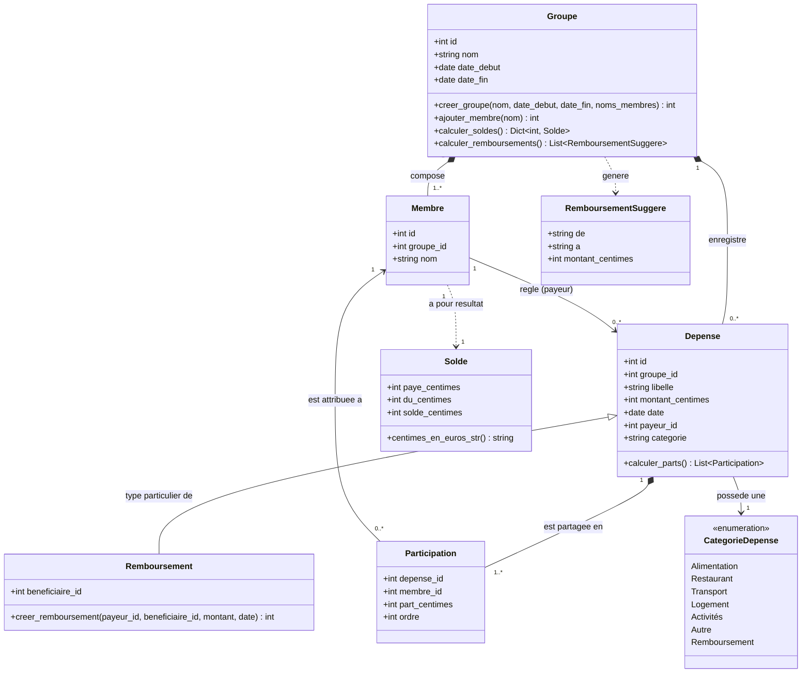

# Diagramme de classes UML — Application de Partage de Frais

Ce document présente le diagramme de classes de l'application de partage de frais, conçu selon les principes de la modélisation objet et reflétant l'architecture de la base de données SQLite et du module métier (`modele.py`).

---

## 📊 Diagramme de classes (Mermaid)

---

## 📝 Description des classes et contraintes métier

### 1. `Groupe`
- Représente un séjour entre amis.
- **Attributs** :
  - `nom` : intitulé du séjour (ex: *Vacances à Spa*).
  - `date_debut`, `date_fin` : période du séjour, avec la règle `date_debut <= date_fin`.
- **Règles associées** :
  - Contient au moins un membre.
  - La somme des soldes de l'ensemble de ses membres est toujours strictement égale à **0 centime**.

### 2. `Membre`
- Représente un participant au séjour.
- **Contrainte d'unicité** : Deux membres d'un même groupe **ne peuvent pas avoir le même nom** (vérification insensible à la casse et contrainte `UNIQUE(groupe_id, nom)` en base).

### 3. `Depense`
- Représente un achat ou une dépense collective.
- **Attributs & Règles** :
  - `montant_centimes` : doit être strictement positif (`> 0 €`).
  - `date` : doit obligatoirement être comprise dans les dates du séjour (`date_debut <= date <= date_fin`).
  - `payeur` : membre appartenant obligatoirement au groupe.
  - `categorie` : obligatoire, choisie parmi les catégories autorisées (`CategorieDepense`).
  - `participants` : liste ordonnée d'au moins un membre du groupe.
- **Règle du centime restant** :
  $$\text{part\_base} = \lfloor \text{montant} / k \rfloor, \quad \text{reste} = \text{montant} \pmod k$$
  Le centime restant va au **premier participant ajouté** (`ordre = 0`).

### 4. `Remboursement` *(Spécialisation de `Depense`)*
- Type de dépense particulier d'un membre vers un autre membre.
- **Payeur** : le membre qui donne l'argent (débiteur).
- **Bénéficiaire** : le membre qui reçoit l'argent (créditeur, unique participant).
- **Catégorie** : automatiquement fixée à `"Remboursement"`.
- **Règle** : Un membre ne peut pas se rembourser lui-même (`payeur != beneficiaire`).

### 5. `Participation` *(Table d'association `depenses_participants`)*
- Associe chaque dépense à chacun de ses participants en enregistrant l'ordre d'ajout et la part exacte en centimes calculée.

### 6. `Solde` et `RemboursementSuggere` *(Objets valeur de calcul)*
- `Solde` : $\text{solde} = \text{total\_payé} - \text{total\_dû}$.
- `RemboursementSuggere` : calcul glouton minimisant le nombre de virements nécessaires pour solder tous les comptes.
